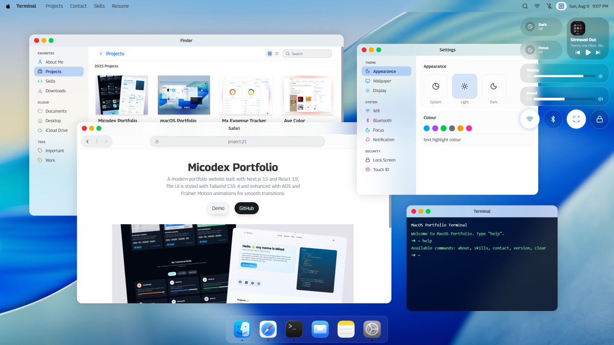

# macOS Portfolio

یک پورتفولیوی تعاملی با الهام از دسکتاپ macOS Tahoe که پروژه‌ها، اطلاعات و مهارت‌ها را در قالب یک محیط دسکتاپ آشنا نمایش می‌دهد. این پروژه با **React، TypeScript، Vite و Tailwind CSS v4** ساخته شده و شامل پنجره‌های قابل تعامل، Dock، نوار منو و اپلیکیشن‌های داخلی است.



**دموی آنلاین:** [مشاهده macOS Portfolio](https://micodex.github.io/macOS-portfolio/) ⚡

## قابلیت‌ها

### تجربه دسکتاپ شبیه macOS

- نوار منو با نمایش اپلیکیشن فعال و ساعت.
- Dock با آیکون‌های اپلیکیشن‌ها و افکت بزرگ‌نمایی هنگام تعامل.
- پنجره‌های قابل جابه‌جایی با امکان باز کردن، بستن، کوچک‌سازی، بزرگ‌نمایی و تغییر پنجره فعال.
- Control Center برای دسترسی سریع به کنترل‌های سیستم به همراه موزیک پلیر.

### شخصی‌سازی ظاهر

- **حالت روشن و تاریک (Light/Dark Mode):** تغییر تم رابط کاربری از طریق کنترل‌های سیستم.
- **انتخاب والپیپر:** امکان انتخاب پس‌زمینه دسکتاپ از بخش تنظیمات.
- **والپیپرهای متناسب با تم:** در صورت تعریف نسخه‌های روشن و تاریک برای یک والپیپر، تصویر متناسب با حالت فعلی انتخاب می‌شود.

### اپلیکیشن‌های داخلی

- **Finder:** نمایش پروژه‌ها و اطلاعات آن‌ها در قالب کارت‌ها و بخش‌های مختلف.
- **Safari:** محیط مرورگر نمایشی برای نمایش صفحه اصلی و جزئیات پروژه‌ها.
- **Notes:** نمایش یادداشت‌ها و اطلاعات کوتاه.
- **Mail:** نمایش نمونه پیام‌ها یا اطلاعات تماس.
- **Terminal:** ترمینال نمایشی برای ارائه مهارت‌ها، اطلاعات و دستورات نمونه.
- **Settings:** محل تنظیمات ظاهری دسکتاپ، از جمله تم و والپیپر.

### رابط کاربری و معماری

- رابط کاربری شیشه ای.
- انیمیشن‌های نرم با کتابخانه `motion`.
- آیکون‌ها با `lucide-react` و `react-icons`.
- ساختار مبتنی بر کامپوننت برای توسعه و نگهداری آسان‌تر.
- مدیریت متمرکز وضعیت پنجره‌ها و کنترل‌های سیستم با `OSContext`.
- تعریف اپلیکیشن‌ها در یک فایل پیکربندی مستقل برای ساده‌تر شدن افزودن یا تغییر اپ‌ها.

## فناوری‌ها

| فناوری                     | کاربرد                              |
| -------------------------- | ----------------------------------- |
| React 19                   | ساخت رابط کاربری مبتنی بر کامپوننت  |
| TypeScript                 | تایپ‌گذاری و کاهش خطاهای زمان توسعه |
| Vite 7                     | اجرای محیط توسعه و ساخت نسخه نهایی  |
| Tailwind CSS v4            | استایل‌دهی رابط کاربری              |
| Motion                     | انیمیشن                             |
| Lucide React و React Icons | آیکون‌ها                            |

## شروع به کار

### پیش‌نیازها

- Node.js نسخه ۱۸ یا جدیدتر
- npm

### نصب وابستگی‌ها

در پوشه اصلی پروژه اجرا کنید:

```bash
npm install
```

### اجرای محیط توسعه

```bash
npm run dev
```

آدرس محلی نمایش‌داده‌شده در ترمینال را باز کنید. آدرس پیش‌فرض Vite معمولاً `http://localhost:5173` است.

### بررسی کد و ساخت نسخه نهایی

```bash
npm run lint
npm run typecheck
npm run build
```

- `lint` مشکلات قابل‌شناسایی توسط ESLint را بررسی می‌کند.
- `typecheck` خطاهای TypeScript را بررسی می‌کند.
- `build` نسخه بهینه‌شده پروژه را در پوشه `dist` می‌سازد.

برای مشاهده نسخه ساخته‌شده به‌صورت محلی:

```bash
npm run preview
```

## ساختار پروژه

```text
src/
├── assets/                  # تصاویر و دارایی‌های مورد استفاده در رابط
├── components/
│   ├── apps/                # اپلیکیشن‌های داخلی دسکتاپ
│   ├── system/              # اجزای سیستم مانند Dock و Navbar
│   └── ui/                  # اجزای رابط کاربری قابل استفاده مجدد
├── context/
│   ├── OSContext.tsx        # وضعیت و منطق اصلی دسکتاپ
│   └── useOS.ts             # هوک دسترسی به وضعیت سیستم
├── data/                    # داده‌های مورد استفاده اپلیکیشن‌ها
├── lib/                     # توابع کمکی
├── App.tsx                  # نمای اصلی دسکتاپ
├── apps.config.tsx          # پیکربندی اپلیکیشن‌ها
└── index.css                # استایل‌های پایه و سراسری
public/                      # فایل‌های استاتیک مانند تصاویر و آیکون‌ها
```

## توسعه و سفارشی‌سازی

- **افزودن یا ویرایش اپلیکیشن:** پیکربندی اپ‌ها را در `src/apps.config.tsx` بررسی کنید و کامپوننت مربوط به اپ را در `src/components/apps/` توسعه دهید.
- **تغییر اطلاعات نمونه‌کار:** داده‌های مربوط به اپلیکیشن‌ها در فایل‌های پوشه `src/data/` و محتوای Finder قرار دارند.
- **افزودن والپیپر:** تصاویر مورد نیاز را به محل مناسب در `public/` اضافه کرده و گزینه‌های والپیپر را در پیکربندی مربوط به آن ثبت کنید. در صورت پشتیبانی از تم روشن و تاریک، مسیر هر دو نسخه و تصویر thumbnail را مشخص کنید.
- **تغییر رفتار سیستم:** وضعیت کلی پنجره‌ها و برخی کنترل‌های سیستم از طریق `OSContext` مدیریت می‌شود.

## انتشار

اسکریپت‌های پروژه شامل دستورهای آماده برای انتشار در GitHub Pages هستند:

```bash
npm run deploy
```

این دستور ابتدا مرحله `predeploy` را اجرا می‌کند که نسخه نهایی را می‌سازد، سپس محتوای پوشه `dist` را با استفاده از `gh-pages` منتشر می‌کند. برای انتشار موفق، مخزن و تنظیمات GitHub Pages باید از قبل آماده شده باشند.

## مجوز و اعتبار

این پروژه به‌عنوان نمونه‌کار شخصی و پروژه‌ای قابل توسعه ارائه شده است. پیش از استفاده مجدد یا انتشار نسخه Fork شرایط مجوز و کپی رایت را بررسی کنید.

**طراحی و توسعه:** میلاد غریبی ☕
